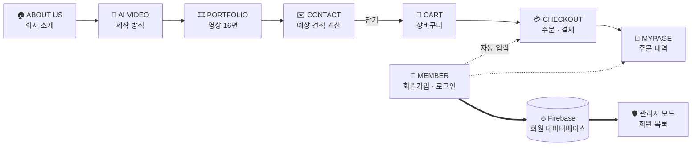
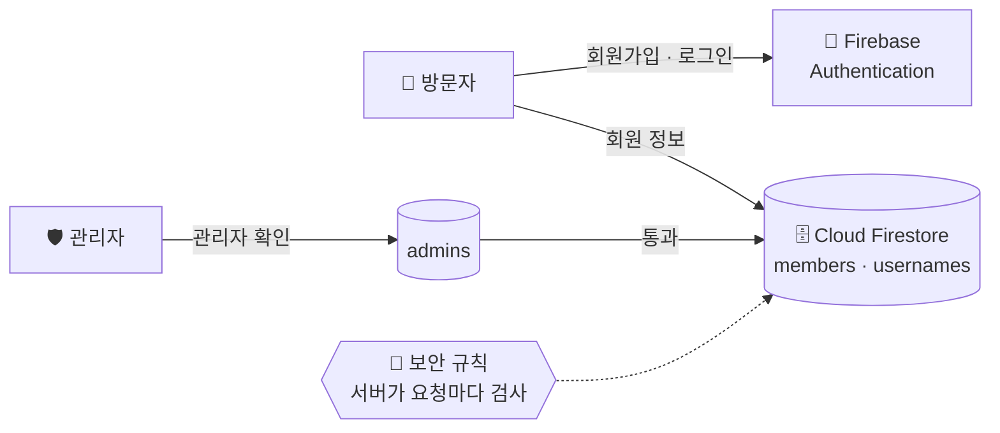
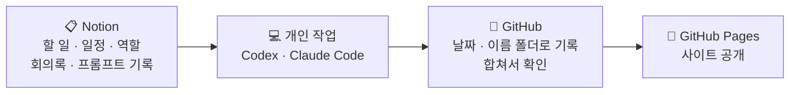

<div align="center">


# STUDIO 상상

### 상상을 넘어, 장면이 되다

기획부터 AI 영상 제작까지 맡아 주는 가상의 AI 영상 제작사 **STUDIO 상상**의 홈페이지<br>
팀원 4명이 **Codex · Claude Code**와 함께 회사 소개부터 **회원가입 · 장바구니 · 결제 · 관리자 모드**까지 만들었습니다.

<br>

[](https://kimsoyeon-saovia.github.io/ksy999/)


<br>


<br><br>

| 👥 팀 | 📅 기간 | 🎤 발표 | 🧭 메뉴 | 🎞️ 포트폴리오 영상 |
| :-: | :-: | :-: | :-: | :-: |
| **인생2막** · 4명 | 2026.10.13 ~ 10.22 | 2026.10.23 | **6개** | **16편** |

</div>

<br>

## 📑 목차

| | | |
| :-- | :-- | :-- |
| 1. [✨ 한눈에 보기](#-한눈에-보기) | 5. [🛒 장바구니 · 결제](#-장바구니--결제) | 9. [🤝 협업 방식](#-협업-방식) |
| 2. [👥 팀원과 역할](#-팀원과-역할) | 6. [🗄️ 데이터베이스 · 관리자 모드](#️-데이터베이스--관리자-모드) | 10. [📱 반응형](#-반응형) |
| 3. [📄 페이지별 소개](#-페이지별-소개) | 7. [🤖 AI 도구 활용](#-ai-도구-활용) | 11. [🧩 문제 해결 기록](#-문제-해결-기록) |
| 4. [🔐 회원가입 · 로그인](#-회원가입--로그인) | 8. [🔍 벤치마킹](#-벤치마킹) | 12. [🚀 실행 · 배포 · 폴더 구조](#-실행--배포--폴더-구조) |

<br>

## ✨ 한눈에 보기

> **견적을 보고 → 담고 → 결제하고 → 다시 보는** 흐름이 한 사이트 안에서 이어집니다.



| 🏠 회사 소개 | 🧮 견적 · 주문 | 🔐 회원 · 관리 |
| :-- | :-- | :-- |
| 타자 효과 메인 배너, 흐르는 파트너 로고, 영상 16편 포트폴리오 | 화질 · 길이 · 수량으로 **예상 견적 자동 계산** → 장바구니 → 결제 → 주문완료 | **Firebase** 회원가입 · 로그인, 카카오 주소 검색, **관리자 모드** 회원 목록 |

<br>

## 👥 팀원과 역할

| | 이름 | 담당 페이지 | 페이지 역할 | 공통 업무 |
| :-: | :-- | :-- | :-- | :-- |
| 01 | **염혜리** (팀장) | 🏠 ABOUT US | 메인 화면 · 협력사 · 회사 소개 | Notion 정리 · 인스타그램 개설 |
| 02 | **이애리** | 🤖 AI VIDEO | AI 영상 제작 과정과 차별점 소개 | PPT 발표 |
| 03 | **유호원** | 🎞️ PORTFOLIO | AI 제작 영상 포트폴리오 구성 | 통합 및 배포 |
| 04 | **김소연** | ✉️ CONTACT | 개인 · 기업 견적 안내 페이지 | GitHub 관리 |

> **1인 1페이지** — 메뉴 4개를 한 사람씩 맡아 완성한 뒤 하나로 합쳤고, 회원 · 장바구니 · 결제 · 관리자 기능은 팀원 모두가 함께 붙였습니다.

<br>

## 📄 페이지별 소개

<table>
  <tr>
    <td width="50%"></td>
    <td width="50%"></td>
  </tr>
  <tr>
    <td><b>🏠 ABOUT US</b> <sub>main/ · 염혜리</sub></td>
    <td><b>🤖 AI VIDEO</b> <sub>ai-video/ · 이애리</sub></td>
  </tr>
  <tr>
    <td></td>
    <td></td>
  </tr>
  <tr>
    <td><b>🎞️ PORTFOLIO</b> <sub>portfolio/ · 유호원</sub></td>
    <td><b>✉️ CONTACT</b> <sub>contact/ · 김소연</sub></td>
  </tr>
</table>

### 🏠 ABOUT US — 회사를 소개하는 첫 화면
- 메인 배너 **"상상을 넘어 장면이 되다"** — 타자 효과 제목 + 좌우에서 날아오는 부제
- 파트너 기업 로고 띠 두 줄이 반대 방향으로 흐름 (65초 무한 반복, **움직임 멈추기** 버튼)
- 서비스 4종: 제작 · AI 하이브리드 · 사운드 · 드론
- "당신이 상상한 모든것을 현실로" 네 단어가 0.14초 간격으로 튀어 오름

### 🤖 AI VIDEO — 제작 방식을 보여 주는 화면
- 배경 영상과 **"당신의 상상이 영상이 되다"** — 제목이 아래에서 위로 진해짐 (문장당 1.2초)
- 하는 일 3단계 **PLAN · CREATE · FINISH**, 제작 과정 4단계 (상담 → 기획 → AI 제작 → 편집)
- 상담 준비 안내창 + **양식 복사** 버튼, WHAT WE DO 텍스트 샤인 · 패럴랙스 스크롤

### 🎞️ PORTFOLIO — 작업물을 모아 보여 주는 화면
- 카테고리 필터 4개(전체 · 개인 · 기업 · 지역)
- 카드에 마우스를 올리면 제목, 누르면 프로젝트 상세창 (개요 · 주요 활용 사례) + 영상 16편 재생

### ✉️ CONTACT — 견적을 내고 상담을 신청하는 화면
- 개인 / 기업 문의 전환, 화질 · 길이 · 수량(1~999)을 고르면 **예상 견적 자동 계산**
- 스크롤을 따라오는 견적서, 상황별 안내창, FAQ · 개인정보 동의
- 견적서의 **담기** 버튼으로 장바구니와 연결

<details>
<summary><b>⚙️ 페이지별 사용 기술 보기</b></summary>

<br>

| 페이지 | 기능 | 사용 기술 |
| :-- | :-- | :-- |
| ABOUT US | 제작 문의 안내창 | `<dialog>` · `showModal()` |
| | 튀어 오르는 문장 · 흐르는 로고 | `IntersectionObserver` · `@keyframes` |
| AI VIDEO | 상담 준비 안내창 · 양식 복사 | `<dialog>` · Clipboard API |
| | 진해지는 제목 · 패럴랙스 | `@keyframes` · `animationend` · `transform` |
| PORTFOLIO | 분류 필터 · 상세창 · 영상 재생 | `data-filter` · `<dialog>` · `<video>` |
| CONTACT | 견적 계산 · 따라오는 견적서 | `inquiry-pricing.js` · `requestAnimationFrame` |
| MEMBER | 로그인 · 회원가입 팝업 | Shadow DOM · Firebase Auth |
| CART · MYPAGE | 장바구니 · 주문 · 주문 내역 | `localStorage` · `history` |
| ADMIN | 회원 목록 · 수정 · 삭제 · CSV | Cloud Firestore · `<dialog>` · `Blob` |

</details>

<br>

## 🔐 회원가입 · 로그인

<table>
  <tr>
    <td width="50%"></td>
    <td width="50%"></td>
  </tr>
  <tr>
    <td align="center">헤더의 <b>MEMBER</b> → 로그인 · 회원가입 팝업</td>
    <td align="center">카카오 주소 검색 → 우편번호 · 주소 자동 입력</td>
  </tr>
</table>

| 항목 | 규칙 |
| :-- | :-- |
| 아이디 | 영문 소문자로 시작하는 4~12자 · **[중복확인]** 은 데이터베이스에서 바로 확인 |
| 비밀번호 | 영문 + 숫자 8자 이상 · 사이트에 저장하지 않고 **Firebase Authentication**이 암호화해 보관 |
| 휴대폰 · 이메일 | 숫자만 입력해도 `010-0000-0000` 자동 하이픈 · 형식이 틀리면 칸마다 빨간 안내 |
| 주소 *(선택)* | 카카오 우편번호 서비스 (API 키 없이 무료) · 상세 주소만 직접 입력 |
| 마이페이지 | 회원 정보 · 주문 내역 · 상담 신청 내역 · 로그아웃 · 회원 탈퇴 |

<br>

## 🛒 장바구니 · 결제

<table>
  <tr>
    <td width="50%"></td>
    <td width="50%"></td>
  </tr>
  <tr>
    <td align="center"><b>01 장바구니</b> — 선택 주문 · 수량 · 부가세 자동 합계</td>
    <td align="center"><b>02 주문/결제</b> — 회원 정보 자동 입력 · 결제 수단 · 약관</td>
  </tr>
</table>

- CONTACT 견적서의 **담기** → 헤더 **CART** 숫자가 톡 커지며 장바구니에 저장
- 체크한 영상만 주문, 수량 −/+ 즉시 재계산, **결제 전에 상담 먼저 받기** 신청
- 카카오페이 · 토스페이 · 네이버페이 · 카드 · 계좌이체 · 무통장 *(시연용 결제 화면)*
- 주문완료 화면 → **마이페이지**에서 지난 주문 확인, **같은 영상 다시 담기**

<br>

## 🗄️ 데이터베이스 · 관리자 모드

처음에는 서버 없이 **브라우저(localStorage)** 에만 회원을 저장해서, 다른 기기에서 가입한 회원은 볼 수 없었어요.
그래서 회원 정보를 **Firebase 데이터베이스(서울 서버)** 로 옮기고, 관리자만 전체 회원을 보는 **관리자 모드**를 만들었습니다.

| | 처음 · 브라우저 저장 | 지금 · Firebase |
| :-- | :-- | :-- |
| 저장 위치 | 가입한 그 브라우저 안 | 서울 리전(`asia-northeast3`) 서버 한곳 |
| 다른 기기에서 로그인 | ❌ | ✅ 같은 아이디로 어디서든 |
| 회원 목록 | ❌ 한곳에서 볼 수 없음 | ✅ 관리자 모드에서 전체 관리 |
| 비밀번호 | 브라우저에 변환해서 보관 | Firebase가 암호화해 보관 |



<table>
  <tr>
    <td width="45%"></td>
    <td>

**🛡️ 관리자 모드** <sub>admin/</sub>

1. 사이트 맨 아래 푸터의 **회원 관리**
2. 관리자로 등록된 아이디로 로그인
3. Firebase가 `admins` 목록에 있는지 확인
4. 통과하면 **전체 회원 목록** 표시

검색 · 정렬 · 정보 수정 · 회원 삭제 · **엑셀(CSV) 저장**<br>
관리자 지정은 Firebase 콘솔에서만 가능해요.

</td>
  </tr>
</table>

**🧱 보안 규칙 — 화면에서 숨기는 게 아니라 서버가 직접 막습니다**

| 데이터 | 본인 | 관리자 | 다른 사람 |
| :-- | :-- | :-- | :-- |
| 회원 정보 `members` | 보기 · 수정 · 탈퇴 | 보기 · 수정 · 삭제 | 🚫 볼 수 없음 |
| 아이디 목록 `usernames` | 가입할 때 등록 | 삭제 | 있는지 여부만 확인 |
| 관리자 목록 `admins` | — | 자기 권한 확인 | 🚫 볼 수 없음 |

> [!NOTE]
> 회원 정보만 데이터베이스로 옮겼고, 장바구니 · 주문 · 상담 내역은 지금도 각 브라우저에 저장되는 **시연용** 기능입니다. Firebase는 무료 요금제(Spark)로 운영해요.

<br>

## 🤖 AI 도구 활용

### Codex와 Claude Code, 이렇게 나눠 썼습니다

| 구분 | Codex | Claude Code |
| :-- | :-- | :-- |
| **맡은 작업** | 메인 · 서브 페이지 전체 | 휴대폰 반응형, 통합 후 점검, 회원 · 데이터베이스 · 배포, GitHub · 발표 자료 |
| **좋았던 점** | 원하는 화면을 이미지로 먼저 만들어 코딩 전에 확인 | 여러 요청을 순서대로 처리, 작업 과정을 실시간 확인 |
| **아쉬웠던 점** | 통합 후 수정 시 요청과 다른 결과, 예전 버전으로 되돌아감 | 이미지 생성 기능이 없어 코딩 전 화면 미리보기 불가 |

### 💡 말보다 그림과 숫자로 요청하기

"살짝 크게", "눈에 띄게"처럼 말하면 결과가 매번 달라졌어요. 그래서 **시안 · 캡처 · 손그림**으로 보여 주고, **px · pt · 초 · 색상 코드**로 요청했습니다.

| 도구 | 이렇게 썼어요 |
| :-- | :-- |
| 🎨 일러스트 | Illustrator로 화면 시안을 그려 보여 주고 같은 배치로 요청 |
| 📏 알캡처 | 영역을 드래그해 px 크기를 재고, 그 숫자를 프롬프트에 그대로 적기 |
| ✏️ 펜 태블릿 | 캡처 위에 고칠 곳과 움직임 방향을 손으로 그려 전달 |
| 🖍️ 그림판 | 간단한 수정은 빨간 박스와 화살표로 고칠 곳만 표시 |

> **수정 요청 공식** — **어디를**(그림판 표시) **+ 얼마나**(px · pt) **+ 무슨 색**(`#E0FF4F`) **+ 어떻게**(초 · 순서) **+ 그대로 둘 것**

```diff
- "견적 박스 좀 오른쪽으로 옮기고, 버튼 눈에 띄게 해 줘"
+ "견적 박스를 지도 오른쪽에 58px 띄워 배치해 줘. 제목 32pt Bold,
+  버튼 #E0FF4F 394 × 80. 첨부한 캡처의 분홍색 박스만 고치고 나머지는 그대로 둬"
```

<details>
<summary><b>🔧 AI가 자주 어긋난 곳과 해결 방법</b></summary>

<br>

| 어긋난 것 | 이런 일이 있었음 | 이렇게 해결 |
| :-- | :-- | :-- |
| 간격 · 크기 | 여백과 글자 크기가 요청할 때마다 달라짐 | px · pt 값으로 고정해서 요청 |
| 글꼴 | 지정하지 않은 기본 글꼴로 바뀜 | 글꼴 이름과 두께까지 적기 |
| 기존 디자인 | 한 곳을 고치면 다른 곳도 같이 바뀜 | '요청한 부분만 수정' + 작업 메모 파일 |
| 움직임 | 효과가 너무 빠르거나 한꺼번에 나옴 | 초 단위와 순서 번호로 요청 |
| 색 | 비슷하지만 다른 색이 들어감 | `#색상 코드`로 지정 |

**규칙** — 요청 끝에 항상 **"나머지는 그대로 둬"** 를 붙였습니다.

</details>

<details>
<summary><b>💬 회원 · 장바구니 · 관리자 기능을 만들 때 한 요청</b></summary>

<br>

| 요청 | 결과 |
| :-- | :-- |
| "CONTACT 옆에 MEMBER 넣고, 누르면 로그인·회원가입 탭 있는 팝업 하나로 만들어줘" | 메뉴 1개 + 탭 2개짜리 팝업 |
| "다른 홈페이지처럼 아이디 만들고 중복검사 하고 전화번호 입력하고 다 있어야 하는데" | 중복확인 · 가입 규칙 · 자동 하이픈 |
| "메뉴에 CART 넣고 개인 견적 담기 버튼이랑 연결해서 장바구니 만들어줘" | 견적서와 같은 목록을 쓰는 장바구니 |
| "결제 전에 상담 먼저 받기 버튼 누르면 상담 안내 내용이 밑에 나와 제출할 수 있게" | 장바구니 아래 펼쳐지는 상담 신청 |
| "회원가입한 사람 목록이랑 관리할 수 있는 방법 만들어 줄 수 있냐" | 관리자 모드 + Firebase 데이터베이스 |

</details>

<br>

## 🔍 벤치마킹

같은 업종(AI 영상 프로덕션) 홈페이지를 각자 찾아 공유하고, **구성과 기능 아이디어만** 참고했어요. 디자인은 베끼지 않았습니다.

| 살펴본 것 | 다른 회사 홈페이지는 | 우리는 이렇게 적용 |
| :-- | :-- | :-- |
| 첫 화면 | 대표 영상 · 큰 문구로 첫인상 | 타자 효과 큰 문구 + 배경 영상 |
| 포트폴리오 | 업종 · 용도별 분류, 썸네일 + 영상 | 개인 · 기업 · 지역 필터 + 영상 16편 |
| 제작 과정 | 상담 → 기획 → 제작 → 납품 소개 | 4단계 카드 + 상담 준비 안내창 |
| 가격 안내 | '문의 주세요'로 가격을 숨긴 곳이 많음 | **예상 견적 자동 계산 → 장바구니 → 결제** |

<br>

## 🤝 협업 방식



| 규칙 | 내용 |
| :-- | :-- |
| **작업 기록** | `날짜_이름` 폴더로 누가 언제 올렸는지 바로 확인 |
| **커밋 메시지** | 무엇을 했는지 한 줄로 — `feat: 포트폴리오 필터 추가` · `fix: 모바일 메뉴 겹침 수정` |
| **원본 보호** | 새 기능은 복사본 폴더에서 작업하고, 확인한 뒤에만 배포 |
| **이어서 작업** | 작업 메모 파일을 만들어 다른 컴퓨터에서도 AI가 먼저 읽고 이어서 작업 |

<br>

## 📱 반응형

<table>
  <tr>
    <td align="center"><br><sub>메인</sub></td>
    <td align="center"><br><sub>CONTACT</sub></td>
    <td align="center"><br><sub>장바구니</sub></td>
  </tr>
</table>

PC 디자인은 그대로 두고, 휴대폰 규칙만 `@media` 안에 덧붙여 공통 파일 `site-header.css`에 모았어요.

| 화면 | 기준 | 적용 내용 |
| :-- | :-: | :-- |
| 🖥️ PC | 751px 이상 | 처음 만든 PC 디자인 그대로 |
| 📱 휴대폰 | 750px 이하 | 글자 · 버튼 크기, 배치, 스크롤 조정 |
| 📱 작은 휴대폰 | 520px 이하 | 로고 아래로 메뉴를 내려 헤더를 두 줄로 |

<details>
<summary><b>📱 페이지별로 휴대폰에서 달라지는 점</b></summary>

<br>

| 페이지 | 휴대폰에서는 |
| :-- | :-- |
| ABOUT US | 메뉴는 로고 아래 한 줄, 협력사 로고 45% 축소, 화면 단위 장면 이동 |
| AI VIDEO | PLAN · CREATE · FINISH 카드를 세로로, 제작 과정 제목 69px → 28px |
| PORTFOLIO | 첫 탭은 제목, 두 번째 탭은 아래에서 올라오는 상세 시트 |
| CONTACT | 하단 고정 견적 바 → 펼치면 오른쪽 위 접기 · 쓸어내려 닫기 |
| MEMBER · CART | 팝업은 입력칸만, 장바구니는 금액 박스 없이 버튼만, 결제 수단 2칸 |

**점검** — 크롬 F12 기기 모드(375 · 390px)와 실제 휴대폰에서 모든 페이지 확인

</details>

<br>

## 🧩 문제 해결 기록

| 문제 | 원인 | 해결 |
| :-- | :-- | :-- |
| 메뉴 · 헤더가 제각각 | 페이지마다 따로 만든 헤더 · 푸터 | `site-header.js` 하나로 모든 페이지에 적용 |
| 글자가 깨져 보임 | 서울체 TTF가 작은 크기에서 획이 무너짐 | 서울알림체 OTF로 통일 |
| GitHub 업로드 거절 | 포트폴리오 HTML 113MB (이미지 32장 내장) | 이미지를 WebP 파일로 분리 |
| 영상 용량 초과 | 영상 한 개 180MB, 전체 약 1GB | H.264 MP4로 압축 + `faststart` |
| 휴대폰에 마우스오버가 없음 | 터치 화면에는 hover 동작이 없음 | 첫 탭에 제목, 두 번째 탭에 상세창 |
| 휴대폰에서 예전 화면이 보임 | 브라우저 캐시 | 파일 주소에 버전 번호(`?v=`) 추가 |
| 다른 기기 가입 회원이 안 보임 | 회원을 각 브라우저에만 저장 | **Firebase 데이터베이스**로 옮기고 관리자 모드 추가 |
| 주소를 골라도 폼에 안 들어감 | 검색창이 헤더 안쪽(Shadow DOM)에 있어 결과를 못 받음 | 검색창만 본문으로 꺼내 같은 자리에 띄움 |
| 파일로 열면 주소 자동 입력 안 됨 | 카카오는 `file://` 화면에 결과를 보내지 못함 | 안내 문구 + 직접 입력, 배포 사이트에서는 정상 |

> 문제가 생기면 **원인을 먼저 찾고**, 고친 내용은 작업 메모에 남겼습니다.

<br>

## 🚀 실행 · 배포 · 폴더 구조

**🌐 배포 주소** — <https://kimsoyeon-saovia.github.io/ksy999/> (GitHub Pages, `main` 브랜치를 그대로 공개)

로컬에서 볼 때는 VS Code **Live Server** 등 아무 정적 서버로 루트의 `index.html`을 열면 됩니다. 별도 빌드나 설치는 없어요.

> [!TIP]
> 파일을 더블클릭해서(`file://`) 열어도 화면은 보이지만, **카카오 주소 자동 입력**은 웹 주소(`http://` · `https://`)로 열었을 때만 동작합니다.

```text
📦 STUDIO 상상
├─ 📄 index.html               # main/index.html로 이동하는 시작 페이지
├─ 🖼️ favicon.ico · icon-*.png  # 상상스튜디오 로고 파비콘
├─ 🎨 reset.css · site-header.css
├─ ⚡ site-header.js           # 공통 헤더 · 푸터 · MEMBER/CART 메뉴 연결
├─ 🔥 member-db.js             # Firebase 연결 (회원가입 · 로그인 · 회원 목록)
├─ ⚡ member.js                # 로그인 · 회원가입 팝업, 카카오 주소 검색
├─ ⚡ cart.js                  # CART 개수 · 담기 안내
├─ ⚡ scene-scroll.js · site-enhancements.js
├─ 📂 main/                    # 🏠 ABOUT US
├─ 📂 ai-video/                # 🤖 AI VIDEO
├─ 📂 portfolio/               # 🎞️ PORTFOLIO (videos/ 영상 16편)
├─ 📂 contact/                 # ✉️ CONTACT (index · personal · corporate, 견적 설정 inquiry-config.js)
├─ 📂 cart/                    # 🛒 장바구니 · checkout.html 주문/결제
├─ 📂 mypage/                  # 👤 마이페이지
├─ 📂 admin/                   # 🛡️ 관리자 모드 (회원 관리)
├─ 📂 social/                  # SNS 이미지
└─ 📂 docs/readme/             # 이 README의 화면 캡처
```

> [!IMPORTANT]
> 모든 파일이 상대 경로로 연결되어 있어요. 옮기거나 배포할 때는 **폴더 구조를 그대로 유지**해 주세요.

<br>

## 🪞 회고

| | |
| :-- | :-- |
| **01 · 보여 주면 빠르다** | 말보다 시안 · 캡처 · 손그림 한 장이 수정 횟수를 줄였습니다 |
| **02 · 숫자로 말하면 정확하다** | px · pt · 초 · 색상 코드로 요청하면 한 번에 원하는 크기와 속도가 나왔습니다 |
| **03 · 참고하되 우리 것으로** | 벤치마킹으로 기본을 잡고, 비어 있던 기능(자동 견적 · 장바구니)을 우리 아이디어로 채웠습니다 |
| **04 · 진짜처럼 만들기** | 브라우저 시연에서 끝내지 않고, 데이터베이스와 관리자 모드까지 붙여 실제 서비스처럼 완성했습니다 |

| 👍 잘한 점 | 🤔 아쉬운 점 | 🔜 다음에는 |
| :-- | :-- | :-- |
| 1인 1페이지로 빠르게 분업<br>날짜·이름 폴더로 작업 기록<br>회원 · 결제 · 관리자까지 확장 | 영상 용량으로 업로드 지연<br>장바구니 · 주문은 아직 브라우저 저장 | 모바일 · 데이터 구조를 처음부터 함께 설계<br>주문 내역도 데이터베이스로 |

<br>

---

<div align="center">


**STUDIO 상상** · 상상을 넘어, 장면이 되다

<sub>팀 **인생2막** · 염혜리 · 이애리 · 유호원 · 김소연</sub><br>
<sub>© 2026 STUDIO 상상 — 수업 프로젝트로 만든 가상의 회사입니다</sub>

</div>
